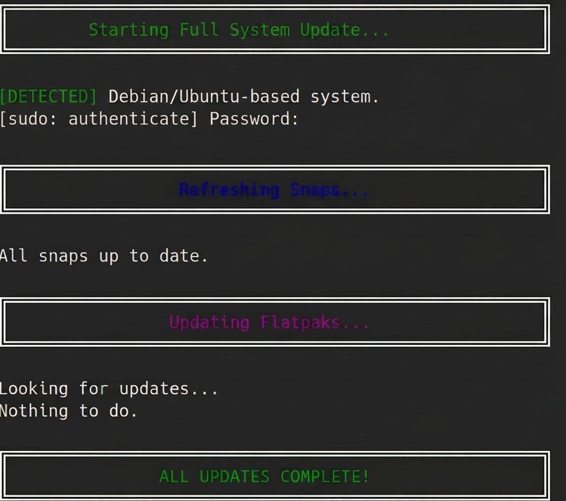

# upall 🚀
Update everything at once. **upall** automates system package, Flatpak, and Snap updates with a single, clean terminal command.

<p align="center">

</p>

## 🌟 Overview
Updating system packages, Flatpaks, and Snaps one by one is repetitive. upall fixes that by providing a single, global terminal command to keep your Linux system and applications up to date—simply and conveniently.

* **One Command:** Run `upall` to update your system and supported applications in one go.
* **Comprehensive Updates:** Covers system package managers, Flatpaks, and Snaps in one run.
* **Clean Output:** Designed to keep the update process clear and easy to follow.

## 💡 Why This Project Exists
I created **upall** because keeping a modern Linux system updated can be annoying.
Today, a single computer often uses **different package ecosystems** at the same time. To fully update your system, you usually have to remember and type several separate commands:
 * `sudo apt update && sudo apt full-upgrade` (for system packages)
 * `sudo snap refresh` (for Snap applications)
 * `flatpak update` (for Flatpak applications)
I wanted a **single, universal command** that could handle everything for me.
This script does the remembering for you. It detects the supported package manager and runs the appropriate update commands. It saves time and helps keep your machine up to date with just one word: `upall`.

## ✨ Features
 * **Auto-Detects OS Base:** Automatically switches its logic between Debian/Ubuntu-based systems (APT) and Arch-based systems (Pacman).
 * **AUR Helper Support:** If you are on an Arch-based system, it dynamically detects and utilizes `yay` or `paru` to update your Arch User Repository packages automatically.
 * **Optional Package Manager Detection:** Checks whether Snap or Flatpak are installed before running their update commands. Snap updates are also skipped unless the `snapd` service is active.
 * **Package Manager Lock Check:** Checks for package-manager locks and retries while waiting for them to clear, before timing out.
 * **Clean & Beautiful Interface:** Formatted with custom ASCII box boundaries, color coding, and terminal spacing so you can easily track update progress.
 * **Desktop Notification:** Sends a completion notification if `notify-send` is available.

## 🚀 How to Install Using the Lazy Installer script (Recommended)
The easiest way to install upall globally on your system is to use the lazy installer script. This will automatically check your OS, install dependencies like `curl` if they are missing, download upall, and make it usable from anywhere.
### Option A: The One-Line Express Installation
Open your terminal and paste this single command to install instantly:
```bash
curl -sL https://raw.githubusercontent.com/cybermaxpower/upall/main/install.sh | bash
```

### Option B: Manual Step-by-Step Installation
If you prefer to download the installer file first, run these commands:
```bash
# 1. Download the installer script
curl -O https://raw.githubusercontent.com/cybermaxpower/upall/main/install.sh

# 2. Make the installer executable
chmod +x install.sh

# 3. Run the installer
./install.sh
```

## 📋 Prerequisites

Before installing upall, make sure `curl` is installed. It is required to download the installer.

If `curl` is missing, install it using your distribution's package manager.

**Debian-based systems:**
```bash
sudo apt update
sudo apt install curl -y
```

Once installed, proceed with the installation instructions below.


## 💻 How to Use upall in the Terminal
Once installed, using the application is incredibly straightforward. It acts just like a native system command.
### Running the App
Open your terminal from anywhere on your system and simply type:
```bash
upall
```

---

## 🧪 Linux Distribution Compatibility

| Distribution Family | Status | Package Manager |
| :--- | :--- | :--- |
| **Debian / Ubuntu / Mint / MX etc** | 🟢 **Supported** | `apt` |
| **Arch / Manjaro / EndeavourOS etc** | 🟢 **Supported** | `pacman` (or `yay` / `paru`, if installed) |
| **Fedora / Red Hat (RHEL)** | 🔴 **Unsupported** | No `dnf` support |

---

## What to Expect When Run:

 * **Screen Refresh:** The script clears the terminal screen to provide a clean workspace. Update output is shown as the process runs.
   A completion message appears when the update process finishes successfully.
 * **Completion Graphic:** A prominent success block appears at the end to indicate that the script has reached its completion stage without a fatal error. It does not guarantee that the system is completely secure.

## 🔒 Why It Asks for Your Password (sudo)

 * Your system requires **administrator privileges (`sudo`)** to safely download, install, and replace core system files.
 * You normally enter your password **once at the beginning**. The script keeps sudo credentials refreshed during updates, although sudo may ask again in some circumstances.

## ⚖️ Warranty & Liability Disclaimer

### NO WARRANTY (PROVIDED "AS IS")
This software is provided completely **"as is"** without any warranty of any kind, either expressed or implied.

### Limitation of Liability
* **Use at Your Own Risk:** The developer is not liable for any system instability, package conflicts, data loss, or system issues that may occur on your computer from installing, running, or updating software using this tool.
* **User Responsibility:** Automatic cleanups (such as removing unused Flatpak runtimes) can modify local configurations or environment setups linked to those packages. It is your absolute responsibility to inspect the script, review what is being changed or deleted, and maintain your own system backups before executing updates.
